# HR recruitment project review — 25 October 2026

Reviewed source: `HRRecruitmentProjectFile.axpp`, SHA-256 `36b203e80af1cc3351abade417fa98abfa9c6dd7ae4db36f0c0a35dac15d435e`, project `UBHRProcess_Nivetha`, model `UBHR_Nive`.

The archive has 247 entries: 14 tables with 203 declared business fields, 14 forms, 42 classes, 66 EDTs, 19 base enums plus one enum extension, five workflow templates/approvals/queries, three services in two service groups, menus, tiles and labels. The XML/project files were parsed, tables/fields/indexes/relations/form bindings inventoried, and service, table, event and workflow source inspected. This is a source review, not an X++ compilation, Visual Studio import test, deployed SQL-index inspection or live business-process test. Omitted metadata properties retain framework/model defaults; their absence is not proof of a particular deployed value.

The required completion scope is application review → screening → three interview rounds → final HR round → selected/rejected. Offers, onboarding and employees already exist in the project and are an optional later extension of that agreed scope.

## Existing tables: reuse these

| Existing table | Current role | Main work remaining |
| --- | --- | --- |
| `UBDepartmentTable` | Department master | Validate manager references and active dates |
| `UBPositionTable` | Position master | Validate department, active position and job links |
| `UBJobRequirementTable` | Job, JD, skills, eligibility and approval | Make approved-workflow eligibility consistent across the two service implementations; expose existing criteria/certification/rubric fields |
| `UBCandidateTable` | Candidate identity, contacts and profile | Populate existing `CandidateName`; keep `CandidateNumber` distinct from `CandidateId`; review identity uniqueness |
| `UBJobApplicationTable` | Candidate/job application, application number, HR recommendation and AI status | Populate name snapshot; define review/hold/final decisions and their authorization; centralize screening transition |
| `UBHRMatchEvaluationTable` | AI score, summary, evidence JSON and human `ScreeningStatus` | Show existing evidence and criteria flag; avoid competing editable decision sources and default shortlist |
| `UBCandidateScreeningTable` | Second verification, recommendation, decision and approval | Reviewer assignment/audit; explicit defaults; rejection decision; unique application linkage; create only at the chosen business transition |
| `UBSkillTable` | Currently mixes skill master and screening line fields | Separate catalog skills from per-screening assessment lines; align key lengths before migration |
| `UBCandidateSkillTable` | Candidate-to-catalog skill relationship | Keep for reusable candidate skills; ensure referenced `SkillId` is unique and compatible in length |
| `UBInterviewTable` | Interview schedule, round, interviewer, scores and result | Reuse for all four rounds; add scheduling/attempt lifecycle and enforce progression |
| `UBInterviewFeedbackTable` | Interview-linked feedback and approval | Add a real interviewer reference, finalization metadata and round consistency |
| `UBOfferTable` | Salary, joining proposal, acceptance and approval | Optional after final HR selection; define offer rejection/expiry/revision if required |
| `UBOnboardingTable` | Joining checks and approval | Optional after offer acceptance; checklist/task details if required |
| `UBEmployeeTable` | Custom employee/interviewer directory | Maintain active interviewer references; decide its relationship to standard D365 workers before expanding |

Every existing column, its declared type/EDT/enum and resolvable string size is in [existing-columns.csv](existing-columns.csv). This prevents proposing an already present column as new. `-1` is exported memo storage; an empty size means the export did not specify a size through its included EDT chain. System fields such as `RecId` are not counted as new business fields.

## Confirmed reason the name is blank

1. React already submits one confirmed `candidate_name` in `/api/applications`. It does not split it. The existing frontend tests cover this.
2. `SQLiteD365Service.submit_application()` split that name and sent `FirstName`/`LastName` to the F&O service.
3. Exported `UBHRPortalApplicationRequestContract` has those members but no `CandidateName` member.
4. `UBHRPortalService.submitApplication()` writes only candidate first/last fields and never writes `UBCandidateTable.CandidateName` or `UBJobApplicationTable.CandidateName`.
5. The application form calls `getCandidateName()`, which returns the candidate master's blank `CandidateName` even if another name source exists. The screening event copies the blank name, and its form has the same display lookup.
6. `UBCandidateForm` binds first/last-name controls and has no full-name control. The candidate table's second title field is `FirstName`.

Both candidate and application `CandidateName` fields already support 500 characters in this export. **No new name column or larger EDT is required.** The portal still validates its existing 200-character confirmed-name limit.

### Prepared name fix

New wire request:

```json
{"_request":{"Company":"DAT","ApplicationId":"APP-<original-guid>","RequirementId":"REQ0016","CandidateName":"A complete confirmed name","Email":"candidate@example.com","Phone":"","LinkedInProfileUrl":"","LinkedInIssuer":"<original issuer>","LinkedInSub":"<original subject>"}}
```

The canonical backend sends only `CandidateName`, not `FirstName`, `LastName` or `FullName`. No name-component inference is performed. The updated F&O contract keeps the two legacy members optional for deployment compatibility; old callers are joined server-side into the canonical name. The service writes the candidate name and application name before application insertion, so the existing screening handler can copy the full name. Existing application/evaluation IDs, frozen payloads, ownership, outbox/retry behavior and resume storage remain unchanged.

The prepared AXPP changes exactly six existing objects:

- `UBHRPortalApplicationRequestContract`: full-name member; legacy accessors retained.
- `UBHRPortalService`: name resolution and candidate/application writes only. The export's custom `requireFieldText()` implementation is preserved.
- `UBCandidateTable`: second title field uses `CandidateName`; number-generation methods remain unchanged.
- `UBCandidateForm`: the three first-name controls bind to the full-name column. Legacy last-name controls remain available for old data.
- `UBJobApplicationTable` and `UBCandidateScreeningTable`: name display prefers the saved application/screening name, then candidate full name, then an old first/last-name fallback.

The other 241 package entries are byte-identical to the uploaded archive. No future-schema proposal, number-sequence registration, workflow or index change is applied by this name patch.

### Deployment order and existing records

1. Import/compare the prepared AXPP in the existing development model. Build it against your F&O version and test the existing table/event handlers. The package is edited source, not a compiled deployable package.
2. Deploy the **F&O changes first** through the normal approved process. The added optional contract member lets the old portal continue using its existing first/last-name request during this stage.
3. Test an intentional application with Postman using `CandidateName`. Verify candidate, application and screening names and acknowledgements. Keep a test application's identity/ID stable when retrying.
4. Deploy this repository's backend change through the existing company pipeline. Do not deploy the backend name mapping alone against the old F&O contract. There is no new App Service variable, secret or database migration.
5. Test a mononym, a multiword name, a Unicode name and a long accepted name. Confirm the candidate's entered name is used instead of a different LinkedIn profile name. Verify identical retries retain one application and private resume.
6. For old candidate records with a blank `CandidateName`, optionally add/build [UBBackfillCandidateNames.xpp](../../xpp/UBBackfillCandidateNames.xpp). Run in the intended company with no arguments for preview counts; only `Args.parm("APPLY")` enables per-record updates. It fills blanks from existing first/last values, never overwrites a nonblank name and logs counts only. It is not automatically executed or added to the AXPP. Per-record commits mean rerunning after a failure resumes safely over remaining blanks.
7. The application/screening display fallback makes old rows readable. Their original full-name snapshots were never saved in F&O, so a fallback to today's master is not proof of the historical submitted name. Recover exact old snapshots only from the authorized frozen portal payload. Do not rewrite every historical name from the latest master.

Backend rollback: restore the prior backend image; the expanded F&O contract still accepts old first/last requests. Do not revert the F&O contract before reverting the backend. Preserve names/data and all unrelated application settings. Restoring the original AXPP does not undo data repair; export/retain old values through the normal maintenance procedure before any APPLY run.

To regenerate the prepared source package locally:

```bash
python scripts/patch_d365_full_name.py original.axpp HRRecruitmentProjectFile.full-name-fix.axpp
```

## Source findings to fix before full rollout

| Priority | Finding in the supplied export | Required action |
| --- | --- | --- |
| P0 | Candidate/application full-name persistence is missing | Deploy the coordinated name fix above |
| P0 | `UBScreeningNumberSeqModule` already registers **`UBScreeningId`, `UBCandidateNumber`, `UBApplicationNumber`** under **`NumberSeqModule::UBHRRecruitment`**. `UBScreeningNumberSeqLoad` already calls `load()` | Use these actual existing classes; do not add the earlier suggested duplicate module/enum. Verify reference initialization and all three sequence assignments in the target environment and DAT. AXPP source does not contain runtime assignments |
| P0 | `UBIdentityKeyIdx` explicitly allows duplicates, while the portal service depends on one candidate per issuer/subject digest | Inspect live duplicates/blanks, resolve identity ownership carefully, then enforce the intended unique index through reviewed metadata migration. Do not merge identities by email or blindly change an index against dirty data |
| P0 | `ScreeningIdx` explicitly allows duplicate screening IDs and no unique `ApplicationId` index is exported | Verify/deduplicate existing screening records; enforce unique screening IDs and one screening per application if this is the chosen lifecycle |
| P1 | `UBCandidateScreeningAutoCreateHandler` creates screening on every application insert; `UBJobApplicationSubmitHandler` also creates/updates screening, including Hold/Reject recommendations | Choose one transactional transition service. For the agreed flow, only saved HR Proceed/Shortlist creates screening; Hold/Reject must not advance. Table-level logic must apply to forms and services. Do not swallow creation errors or use `doInsert()` to bypass handlers |
| P1 | `UBHRJobStatus` symbols are `Shorlist`, `Hold`, `Reject`; zero defaults to `Shorlist`. `UBScreeningDecision` has NotSelected/OnHold/Shortlisted, no Rejected. Screening `initValue()` sets workflow Draft but not decision/recommendation | Define explicit neutral defaults, append required enum values and initialize them. Preserve existing enum numeric values; correct the displayed shortlist label without casually renaming a symbol used by integrations |
| P1 | Two editable HR decision concepts appear in evaluation `ScreeningStatus` and application `UBScreeningRecommendation` | Choose an authoritative application-review decision and make the other a projection/controlled update. AI completion must not silently shortlist or reject a person |
| P1 | Screening Resubmit menu item `Object` is the label reference `@UBHR:Resubmit`, not a class. Offer Resubmit points to `UBInterviewFeedbackWorkflowSubmitManager`, which expects a feedback record | Correct these action bindings to the appropriate implemented resubmit managers; keep labels in Label, not Object. These are concrete metadata defects in the export |
| P1 | All five `*ApprovalResubmitActionMgr.main()` bodies contain TODOs only; several returned/canceled callbacks are empty | Implement and test the actual return/change-request/resubmit/cancel paths after correcting their bindings. Most submit managers only permit Draft, so a ChangeRequested record cannot simply be submitted by the current method |
| P2 | The unused custom `UBJobRequirementWorkflowCancelManager` only changes table status. The exported requirement Cancel menu instead points to standard `WorkflowCancelManager` | Preserve the working standard binding. Do not wire the custom class into a cancel action without implementing actual workflow cancellation and consistent status updates |
| P1 | Screening's initial submit/document/query bindings point to the screening table, and its submit manager checks `TableId`; its Resubmit binding is defective as noted above | The previously reported screening-to-requirement cast is not reproduced by the initial submit bindings in this export. Debug the deployed stack if it persists; avoid a global replacement of job-requirement classes |
| P2 | Offer Cancel points to `WorkflowCancelUnrecoverableWorkflowFeature`, whereas the other exported cancel actions use `WorkflowCancelManager` | Verify the intended supported callable action in the target version; a feature class name is not evidence of a valid workflow-cancel entry point |
| P1 | Form workflow settings are inconsistent: onboarding has a workflow template but its form does not explicitly enable workflow; job-requirement form enables workflow without an explicit WorkflowType; AI evaluation form enables workflow without a matching exported workflow type | Align each form's workflow datasource/type/settings with its intended approval process. Test the action bar and menu actions in the deployed environment; do not invent another approval workflow for AI output merely because WorkflowEnabled is set |
| P1 | Onboarding approval change-request handler writes Returned, while its submit manager permits Draft or ChangeRequested | Use consistent status semantics and a real resubmit path if onboarding is retained |
| P1 | `UBSkillTable` is both a catalog lookup target and a screening-line store. SkillId is 500 characters/nonunique there, but candidate-skill references use the 20-character `UBSkillId` EDT. Several screening/application link fields have no explicit size/EDT | Normalize the master and line roles, choose compatible lengths from actual data, and migrate references before changing constraints. Both shown skill indexes allow duplicates, so this export alone does not identify the earlier duplicate-record exception's actual database constraint |
| P1 | Interview/feedback forms and tables exist, but no exported transition handler schedules the next round or gates the HR round | Implement server-side progression and assignment; four separate tables for four rounds are unnecessary |
| P1 | `UBHRPortalService.acceptsApplications()` checks open status/dates, while the older `UBHRApplicationService` additionally requires Approved workflow | Decide one approved eligibility rule and keep canonical portal and ERP publication consistent. Retire/restrict the old email-matching/new-ID-per-call service after checking consumers; it is not the portal's retry-safe endpoint |
| P2 | `getCandidateNumber()`/`getApplicationNumber()` select only the number field, then test `RecId` | Include `RecId` in the selected fields when testing it, or select the full buffer; verify this display behavior in F&O |
| P2 | AI form binds score/summary/status but does not expose existing `MeetsMinimumCriteria`, `MatchLabel` and evidence JSON as useful controls; interviewer identity/evidence fields are also absent from the feedback controls | Add views/controls over existing fields before creating duplicate columns |
| P2 | Most tables do not explicitly enable all four created/modified audit properties in the export | Enable appropriate standard audit properties and use standard workflow tracking; do not add duplicate custom CreatedBy/CreatedDateTime fields |
| P2 | No custom security roles/duties/privileges or data-entity definitions are included | Verify whether they exist elsewhere. Define HR/interviewer/recruiter access and privileges for exposed operations; the export alone cannot prove production permissions or active workflow configurations |

## Proposed columns on existing tables

These are future design proposals, **not implemented migrations**. Keep existing columns and enum values. Review requiredness, relations, history and existing data before synchronizing schema changes.

The [proposed-columns.csv](proposed-columns.csv) lists the 12 recommended additions on existing tables and every proposed new-table column, with optional scope marked separately. Standard `RecId`/company/audit fields and enum extensions are not duplicated as proposed business columns.

| Existing table | Recommended additions | Type/purpose |
| --- | --- | --- |
| `UBJobApplicationTable` | `FinalDecisionBy`, `FinalDecisionDateTime`, `FinalDecisionReason` | UserId, UTC datetime, memo; final HR accountability. Reuse existing ApplicationStatus for Selected/Rejected rather than another final-result column |
| `UBCandidateScreeningTable` | `ReviewerEmployeeId`, `ReviewedBy`, `ReviewedDateTime` | Existing employee-ID EDT/FK, UserId, UTC datetime; assignment and actual reviewer. Reuse ReviewerComment, decision, recommendation and workflow status |
| `UBInterviewTable` | `AttemptNo`, `ScheduleStatus`, `DurationMinutes`, `MeetingLocationOrUrl`, `CompletedDateTime` | Integer; scheduling enum; integer; bounded string; UTC datetime. Existing InterviewRound is 1–4 with HR at 4; no extra round-number column needed |
| `UBInterviewFeedbackTable` | `InterviewerEmployeeId` | Existing employee-ID EDT/FK, replacing reliance on an unlinked free-text Interviewer value; retain old text as legacy display during migration |
| Core transactional tables | Standard `CreatedBy`, `CreatedDateTime`, `ModifiedBy`, `ModifiedDateTime` metadata properties | Enable built-in audit fields where appropriate, not new business columns |

Optional, only if required: screening `ReviewDueDateTime` for SLAs; application `CurrentRound` as a controlled summary cache rather than another independent status; interview timezone metadata if externally entered scheduling requires it. Use existing UTC interview datetime for storage and localized display.

Enum changes: append `OnHold` to UBApplicationStatus; add a neutral not-reviewed state for the application-review selector and explicitly initialize it; append Rejected to UBScreeningDecision. Preserve all stored ordinals. Keep workflow approval, human recommendation, interview result and AI processing status separate in meaning.

## Recommended new tables

| New table | When needed | Columns |
| --- | --- | --- |
| `UBScreeningSkillTable` | Recommended now to separate screening line assessments from the catalog | `ScreeningId` FK, `LineNum` integer, optional `SkillId` FK, `SkillDescription` memo for free-text criteria, `MatchStatus` enum, `ExperienceYears` real, `ReviewerComment` memo, standard audit fields |
| `UBRecruitmentDecisionHistoryTable` | Recommended for manual business-decision audit outside workflow tracking | `ApplicationId` FK, `Stage` enum, `FromStatus`/`ToStatus` stable symbols, `Reason` memo, `ChangedBy` UserId, `ChangedDateTime` UTC, optional `ScreeningId`/`InterviewId` context |
| `UBInterviewPanelMemberTable` | Optional: multiple interviewers per session | `InterviewId` FK, `InterviewerEmployeeId` FK, `PanelRole`, standard audit fields; unique interview/interviewer combination |
| `UBInterviewRoundSetupTable` | Optional: configurable rounds instead of the agreed fixed four | `RequirementId` FK or explicit template scope, `RoundNo`, `RoundName`, `IsHRRound`, `IsMandatory`, `DefaultInterviewerEmployeeId`, `SequenceOrder`, standard audit fields |
| `UBOnboardingTaskTable` | Optional after selected/rejected scope, if detailed task tracking is required | `OnboardingId` FK, `TaskId`, `TaskType`, `AssignedUserId`, `DueDateTime`, `CompletedDateTime`, `Status`, `Remarks` |

New screening-line uniqueness should use `(ScreeningId, LineNum)`. Enforce catalog `SkillId` uniqueness and compatible FK lengths through a data-reviewed migration; never shrink existing values to 20 characters blindly. Retain `UBCandidateSkillTable` for candidate skills across applications. Do not create new customer/candidate/interview-header tables or a table per round.

Use standard F&O document management or a secure portal link for resumes before proposing another document table. The existing endpoint is `/api/hr/applications/{application_id}/resume` on the portal's verified public hostname; it requires HR authentication. The lean service does not populate F&O's existing ResumeBlobKey/ResumeFileName columns. Empty ERP resume columns therefore do not prove an upload failed. Never persist a public Blob SAS as a permanent resume link.

## Required ERP behavior and forms

```mermaid
flowchart LR
    J[Approved open requirement] --> A[Application and AI evaluation]
    A --> R[HR review: shortlist / hold / reject]
    R -->|shortlist| S[Candidate screening]
    S -->|approved and proceed| I1[Round 1 assigned]
    I1 -->|passed| I2[Round 2 assigned]
    I2 -->|passed| I3[Round 3 assigned]
    I3 -->|passed| HR[Final HR round]
    HR --> D[Application Selected or Rejected]
```



Hold pauses the application, rejection closes it with a reason, and cancellation/resubmission uses an explicit audited path. One candidate can apply to multiple requirements; business decisions belong to the application, not only the shared candidate master. An interviewer cannot mark the whole application Selected merely by passing round 1. Only the authorized final HR action can set the final application outcome after all required rounds pass.

Reuse UBInterviewForm filtered by application and round, with a session row per round/attempt. Use its existing InterviewerEmployeeId for the selected interviewer. Prevent two active attempts for the same application/round and create the next round only once inside the same transition transaction. Existing InterviewResult and approved feedback/recommendation must produce one consistent progression rule; validate score ranges 0–100 on the server. Feedback Round must agree with its parent interview's InterviewRound.

Add an application drill-down showing full name, private resume action, AI evidence, HR decision, screening and round history. Screening needs reviewer assignment, reason and approve/hold/reject actions. Interviewers need a filtered "my interviews" view and feedback entry; HR needs final outcome/reason controls. Expose the existing evidence, MatchLabel and criteria flag on the AI review form. Enforce readonly completed/approved records and authorized corrections at the table/service layer as well as forms.

## Release and acceptance checks

- Compile/import and test F&O first, then backend; verify no portal-only rollout against the old contract.
- Verify all three existing number references/assignments under the integration's company and execution context.
- Submit a confirmed full name, check all three ERP names, verify accepted acknowledgement and retry with no duplicate rows/resumes.
- Preview old-name repair; apply only to the intended company if needed; inspect old-name display fallbacks.
- Shortlist once creates one screening; repeated save does not duplicate; Hold/Reject do not advance. Test independent applications for the same person.
- Screening approval/hold/reject and change-request/resubmit/cancel all preserve correct workflow and business status.
- Pass rounds 1–3 in order, assign the intended interviewer, then allow final HR selection/rejection. Test rescheduling and duplicate feedback deliveries.
- Save multiple skill lines for one screening; verify no truncated keys and correct parent filtering.
- Validate HR/interviewer permissions and document access with ordinary user accounts, not only System administrator.
- Deploy and live checks remain external to this workspace. No production data, settings, schema, workflow or sequence assignment has been changed by this review.
