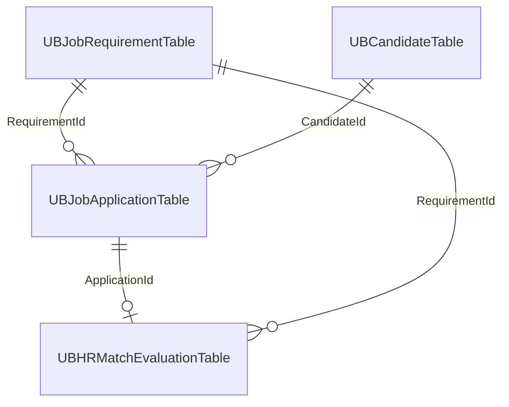

# F&O business records and portal metadata

Use model `UBHR_Nive` with the existing four portal integration tables. [TABLES.md](../d365/TABLES.md) lists their selected fields. The [25 October AXPP review](../d365/review/2026-10-25/README.md) inventories all 14 supplied tables and separates future ERP proposals from the name fix, which requires no new fields.

| Store | Information |
| --- | --- |
| `UBJobRequirementTable` | Authoritative full JD, advertised conditions, skills/qualifications, dates/status and job evaluation criteria |
| `UBCandidateTable` | Current confirmed full `CandidateName`, email, phone, profile URL and validated issuer/subject identity; first/last fields retained for legacy callers |
| `UBJobApplicationTable` | Stable application ID, candidate/job IDs, submitted `CandidateName` snapshot, existing human status, AI status and overall score |
| `UBHRMatchEvaluationTable` | Stable evaluation/application/job IDs, score, criteria flag, label, summary and core evidence/gaps JSON |
| SQLite or PostgreSQL | Frozen application contacts and JD snapshot, timestamps, private resume reference/name/hashes, consent, allowlisted LinkedIn profile, retry/acknowledgement state and full AI result/provenance |
| Private Azure Blob | Actual validated PDF/DOCX documents |
| Redis | Connected sessions, transient coordination and worker queue |

Links use the existing identifier fields shown in the screenshots. Generated application/candidate/evaluation IDs need 40-character storage. Candidate identity uses the exact validated issuer/subject pair and a unique 64-character SHA-256 `IdentityKey`; email/name are contact data, not identity keys. Unique existing indexes protect IDs and identity under concurrent writes. The service does not require new RecId reference columns.

## Persistence sequence

1. Sign in with LinkedIn from a job and return to that job/form. Show available provider details and let the candidate confirm missing contacts. Sign-in alone writes no application.
2. Store the validated private resume, immutable submission intent and selected full JD snapshot in the metadata store before delivery. The application ID and payload are frozen for retries.
3. Call `submitApplication`: F&O atomically upserts the candidate and inserts the candidate/job-linked application. Verify matching acknowledgement before marking the local submission accepted.
4. Queue only acknowledged work. The separate worker reads the uploaded document and frozen full JD, calls Azure OpenAI and validates the complete result.
5. Save the full result in portal metadata, call `saveCandidateEvaluation` with its core fields, then expose a completed result only after a matching F&O acknowledgement. The F&O transaction updates the evaluation and application score/AI status together.

The selected metadata engine is durable portal storage, not an expendable cache. It preserves immutable per-application contacts even when a later submission updates the F&O candidate master. Technical screenshot fields remain unused by the lean writes. F&O kernel timestamps and existing table defaults may still be maintained independently.

A real completed score of zero is preserved; pending/failed work has no confirmed evaluation. AI evidence never automatically changes human review status or accepts/rejects a candidate.

## Retry and identity rules

Portal metadata stores the original request key and frozen payload, rejecting changed reuse. ApplicationId stays stable across ambiguous HTTP timeouts. F&O returns the existing record only when its candidate/job links agree; unique application and identity indexes are essential. The same deterministic EvaluationId updates one current assessment, preventing duplicate worker deliveries. Historical AI versions would need a separately reviewed design.

`Company` must equal the mapped integration user's `curExt()`. Parameterless job reads use that company. All ID lookups and portal metadata reads remain scoped to the configured company; browser-selected companies are not supported.

## Operational limits

History, detail and rankings include acknowledged applications submitted through this portal. They do not import existing F&O applications or synchronize recruiter edits. The portal's human-review status is currently the initial `Submitted` snapshot; F&O `ApplicationStatus` uses existing `initValue()` defaults and is not read back by these three methods.

API and worker must open the same durable SQLite file on one host/shared local volume. SQLite WAL is not a multi-host server database and should not be put on SMB/NFS. Back up the database consistently together with its private-document and F&O recovery policy. `RETENTION_DAYS` controls temporary Redis retention, not automatic SQLite/F&O/Blob deletion.

Actual resumes remain private Azure blobs. Store no public document URL, Base64 upload, OAuth token or raw token response in these business tables. The metadata LinkedIn snapshot is allowlisted provider metadata, separate from the candidate's confirmed contact email.

See the [paste/setup guide](../d365/README.md), [three wire contracts](d365-endpoints.md), [deployment](deployment.md), and [validation boundary](validation.md). X++ compilation and live synchronization/security acceptance have not been performed in the cloud workspace.

Optional `METADATA_BACKEND=postgres` moves metadata to the dedicated PostgreSQL/Supabase `talentmatch` schema with verified TLS and no public grants. The ERP contract remains `D365_CONTRACT_MODE=sqlite`. Use the explicit [migration procedure](supabase.md); start with one active connected stack or deliberately shared Redis/Blob coordination. PostgreSQL evaluation advisory locks add duplicate-work protection. The database contains references, not original resume bytes.
